# plymouth-themes

Custom Plymouth boot themes. Small scenes for the moments before everything begins.

Fourteen boot splashes for [Plymouth](https://gitlab.freedesktop.org/plymouth/plymouth),
made for machines with an encrypted disk. Each theme draws the LUKS passphrase
prompt itself and reacts to what you type: a wrong passphrase scrambles a
cellular automaton, startles a swarm of fireflies or sends a cosmic-ray shower
through a cloud chamber. They work just as well without encryption, and
thirteen of them have a screen of their own for power-off and reboot.

Everything is computed while the machine boots, by Plymouth's script plugin;
only `pedro-raccoon-luks` plays a pre-drawn animation. All text comes from
bitmap glyphs inside the theme folder, so nothing depends on fonts or on
Plymouth's label plugin being in the initramfs.

<table>
<tr>
<td width="50%">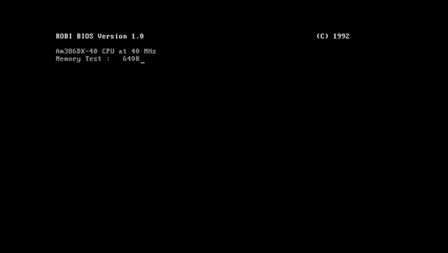<br><b>robi-386</b> · a PC from 1992 boots Linux</td>
<td width="50%">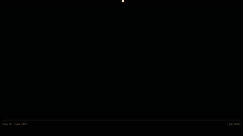<br><b>eca</b> · an elementary cellular automaton</td>
</tr>
<tr>
<td>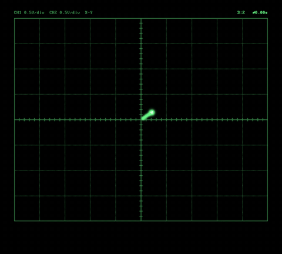<br><b>oscilloscope</b> · Lissajous figures on green phosphor</td>
<td><br><b>pedro-raccoon-luks</b> · Pedro, now with a passphrase prompt</td>
</tr>
<tr>
<td>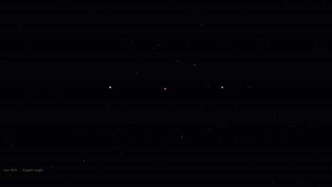<br><b>trisolaris</b> · three suns, a live three-body simulation</td>
<td>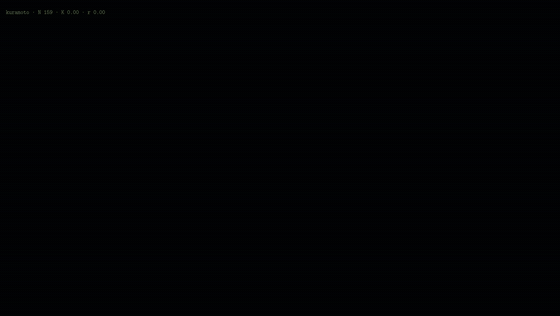<br><b>fireflies</b> · a swarm that learns to flash in unison</td>
</tr>
<tr>
<td>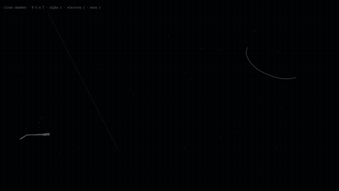<br><b>cloud-chamber</b> · particle tracks in supersaturated vapour</td>
<td>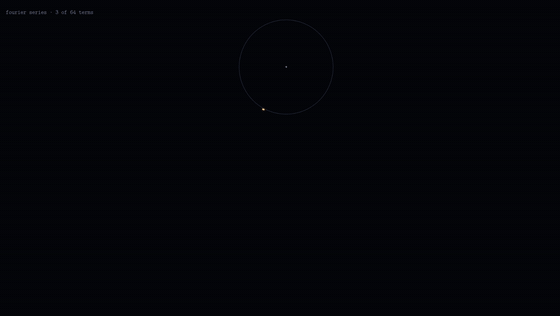<br><b>epicycles</b> · circles on circles draw a key</td>
</tr>
<tr>
<td><br><b>hilbert</b> · a pen plotter draws a space-filling curve</td>
<td>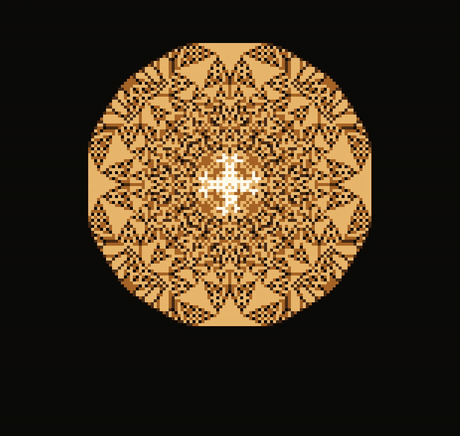<br><b>sandpile</b> · avalanches of every size, in slow motion</td>
</tr>
<tr>
<td>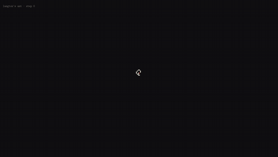<br><b>langtons-ant</b> · ten thousand steps of chaos, then a highway</td>
<td><br><b>waterfall</b> · the 433 MHz band on a software radio</td>
</tr>
<tr>
<td>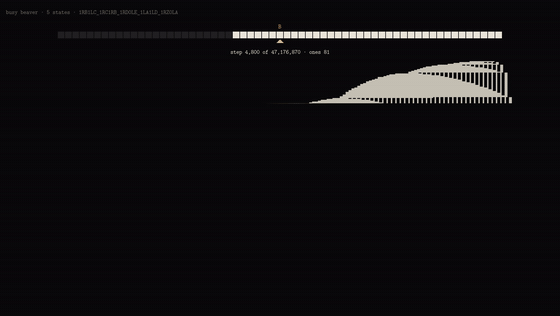<br><b>busy-beaver</b> · the five-state champion, running live</td>
<td>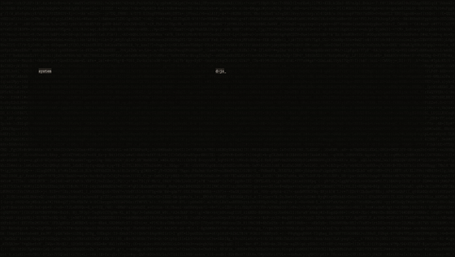<br><b>readback</b> · the boot, written into the machine's name</td>
</tr>
</table>

Each preview is a recorded boot: the prompt, a wrong passphrase, the retry
with a typo corrected, the unlock.

## The themes

**robi-386.** A PC from 1992 boots Linux in VGA text mode: POST and memory
count, a DOS prompt, `LOADLIN`. The passphrase is asked for by `UNLOCK.BAT`,
typed as asterisks, refused with *Access denied*. At power-off: *Heads
parked. It is now safe to turn off your computer.*

**eca.** An elementary cellular automaton, one generation per row, written by
a sweeping head while older rows fade like phosphor. Rule and first row follow
from the seed shown at the bottom left, so a pattern can be had again. Every
keystroke flips a cell, a wrong passphrase scrambles a whole band. At
power-off rule 128 erodes everything.

**oscilloscope.** Lissajous figures on an XY scope: the beam runs through
frequency ratios while the phase drifts. Keystrokes disturb the signal; after
Enter the figure locks to 1:1, a circle, and a wrong passphrase tears it apart.
At power-off the picture collapses like on an old tube.

**pedro-raccoon-luks.** [Pedro Raccoon Plymouth](https://www.opendesktop.org/p/2148515)
with a prompt for encrypted disks; Pedro dances faster while you type. It also
fixes the original loop, which skipped the last frame and showed an empty one.
The animation is not part of this repository: install the original theme
first, and `install.sh` takes the frames from there.

**trisolaris.** Three suns in a live three-body simulation. Every boot starts
on a known periodic orbit (figure-eight, butterfly, moth, yin-yang, goggles,
dragonfly); rounding errors soon tip it into chaos. A keystroke nudges a sun, a
wrong passphrase all three. When a sun is flung out, the era ends and a new one
begins. At power-off gravity fades away.

**fireflies.** A swarm of fireflies as coupled oscillators (the Kuramoto
model). The coupling grows during boot, so you watch them go from twinkling at
random to flashing together. Typing knocks a few out of step, a wrong
passphrase startles all of them, Enter pulls them into tight unison. At
power-off they go dark one by one.

**cloud-chamber.** Particle tracks condensing in supersaturated vapour: short
thick alphas, thin electrons curling up in the magnetic field, long straight
cosmic muons. Each keystroke sends a particle through, a wrong passphrase a
cosmic-ray shower, the right one a V: a neutral particle decaying into two. At
power-off the chamber warms up and the tracks thin out.

**epicycles.** Circles riding on circles draw the outline of a key, a Fourier
series of 64 terms, largest first. During boot the terms come in one by one.
At the prompt only three are left and every character brings two more; a wrong
passphrase throws them out, the right one brings all of them back and the key is
drawn clean. At power-off the circles go, smallest first.

**hilbert.** A pen plotter draws a Hilbert curve through all 4,096 cells of a
64 × 64 grid, and the curve is the progress bar. Your passphrase is plotted in
red; a wrong one is wiped back, the right one dries to black. At power-off the
plotter retraces the curve and lifts it off the paper.

**sandpile.** The abelian sandpile of Bak, Tang and Wiesenfeld: grains fall
onto the middle, cells with four grains topple, and avalanches of every size
grow a fractal mandala, in slow motion. A keystroke drops a pinch of grains, a
wrong passphrase a whole sack; the pattern stays symmetric either way. At
power-off the wind takes the sand.

**langtons-ant.** One ant, two rules: about ten thousand steps of chaos, then
the ant starts building a highway. Typing flips cells in front of it, a wrong
passphrase scrambles a block around it. The rules are reversible, so at
power-off the ant walks its whole path back until the grid is empty.

**waterfall.** The 433 MHz band on a software radio, spectrum above,
waterfall below: a beacon, a transmitter drifting with its temperature, a Morse
beacon, a weather station, a LoRa channel. Every keystroke goes out as a LoRa
packet; the right passphrase is answered by the gateway, a wrong one by a
jammer across the band. At power-off the stations go quiet.

**busy-beaver.** The five-state busy beaver champion runs live, with the tape
around its head and a space-time diagram below. It would halt after 47,176,870
steps, which at boot speed takes well over an hour. It ignores your typing; a
wrong passphrase sends it back to step 0, and at power-off it says how many
steps it was short of halting.

**readback.** Nothing on this screen is made up. Before the passphrase it is
a field of noise, standing in for what the encrypted disk is without its key.
systemd reports every unit it has started to Plymouth by name, and readback
writes those names, in that order, into the letters of the machine's name,
until the name stands there made of the names of its own parts; what no longer
fits runs on, dimmer, into the noise. Of the passphrase it shows what Plymouth
tells a theme, the number of characters, and says that this is all it sees. At
power-off nothing is reported any more, and the name is only an outline.
`install.sh` writes the hostname into the theme (`--name` sets another one);
the copy in `themes/` says `localhost`, and so does the preview.

## Install

```sh
git clone https://github.com/frnkptrln/plymouth-themes.git
cd plymouth-themes
./install.sh --list             # the themes
./install.sh --check            # plymouth, kernel parameter, initramfs hooks
sudo ./install.sh fireflies     # install, make it the default, rebuild the initramfs
```

`install.sh` copies the theme to `/usr/share/plymouth/themes/<name>`, makes
it the default with `plymouth-set-default-theme` and rebuilds the initramfs
with `limine-mkinitcpio`, `mkinitcpio -P` or `update-initramfs -u`, whichever
it finds; with dracut it leaves the rebuild to you. The theme has to be in the
initramfs, or the passphrase prompt comes up as text. `--no-rebuild` skips the
rebuild, and `sudo ./install.sh --use <name>` switches to any installed theme.
To remove a theme, switch to another one and delete its folder under
`/usr/share/plymouth/themes`.

What a splash needs besides the theme:

- `splash` (and usually `quiet`) on the kernel command line.
- With mkinitcpio, the `plymouth` hook after `base` and `udev` (or `systemd`)
  and, for an encrypted root, before `encrypt` (or `sd-encrypt`):

  ```
  HOOKS=(base udev plymouth autodetect microcode modconf kms keyboard keymap consolefont block encrypt filesystems fsck)
  HOOKS=(base systemd plymouth autodetect microcode modconf kms keyboard sd-vconsole block sd-encrypt filesystems fsck)
  ```

`./install.sh --check` looks at both and says what is missing.

## Try a theme without rebooting

From a text console (Ctrl+Alt+F3), not from a terminal window:

```sh
sudo ./install.sh eca --no-rebuild
sudo ./preview.sh eca               # a boot with a passphrase prompt
sudo ./preview.sh eca plain         # a boot without one
sudo ./preview.sh eca shutdown      # power-off (or: reboot)
```

The preview asks twice with the same prompt, so the first answer counts as a
wrong passphrase. Then it sends the units of the running system in the order
they started at this boot, the way systemd does while booting: readback writes
them, the other themes ignore them. What you type is thrown away, and the
previous default theme is put back afterwards.

## Notes

- **What a theme sees.** Plymouth hands a theme the prompt text and the
  number of characters typed, never the characters of a passphrase.
- **Wrong passphrases.** Plymouth does not tell a theme that a passphrase was
  wrong. The themes notice when the same prompt comes back right after an
  answer, and react then.
- **Several disks.** Each prompt names its disk; a prompt too long for the
  screen is shortened in the middle (`robi-386` wraps it, like a console).
- **Keyboard layout.** The layout at the prompt comes from the initramfs (the
  `keymap` or `sd-vconsole` hook), not from the theme.
- **High-density screens.** On a dense screen Plymouth draws with a device
  scale of 2, so a theme renders at half the resolution and comes out softer.
  `DeviceScale=1` in the `[Daemon]` section of `/etc/plymouth/plymouthd.conf`,
  or `plymouth.force-scale=1` on the kernel command line, gives full
  resolution at a higher CPU cost.
- **CPU.** Plymouth runs a theme's script 50 times a second. Share of one CPU
  core that plymouthd took at 1920 × 1080 on the test machine, the mean of two
  runs of `bench/cpu.sh` (eca and trisolaris vary more, with the rule or the
  orbit they start from):

  | theme | CPU | theme | CPU |
  |---|---:|---|---:|
  | robi-386 | 5 % | busy-beaver | 13 % |
  | pedro-raccoon-luks | 7 % | waterfall | 15 % |
  | cloud-chamber | 8 % | fireflies | 17 % |
  | readback | 9 % | sandpile | 17 % |
  | langtons-ant | 10 % | epicycles | 22 % |
  | eca | 11 % | oscilloscope | 26 % |
  | hilbert | 12 % | trisolaris | 29 % |

  At 3840 × 2160 with `DeviceScale=1` the heavy ones need about twice as
  much (trisolaris 60 %, oscilloscope 50 %); robi-386 stays at 5 %.

## Rebuilding the themes

`themes/` holds the built themes, `src/` the Python that generates them: one
`theme_*.py` per theme, the shared script library and glyph engine in
`lib.py`, image helpers in `art.py` and `fontkit.py`.

```sh
python3 -m pip install -r requirements.txt     # Pillow
python3 src/build.py                           # every theme, into themes/
python3 src/build.py fireflies eca             # only these
python3 src/build.py --list
```

The build needs Latin Modern Mono and Latin Modern Sans Bold (Arch:
`otf-latin-modern`, Debian/Ubuntu: `fonts-lmodern`; or point `LMMONO` and
`LMSANSBOLD` at `lmmono10-regular.otf` and `lmsans10-bold.otf`). It is
deterministic: with the Pillow version from `requirements.txt` it reproduces
`themes/` byte for byte, which CI checks. Other Pillow versions give the same
themes with slightly different PNG files.

## Testing

`bench/` runs plymouthd with its X11 renderer inside Xvfb and drives it with
`xdotool`, so a theme can be typed into, recorded and timed without
rebooting. It needs root, Plymouth's x11 renderer (Debian/Ubuntu:
`plymouth-x11`), Xvfb, xdotool and ImageMagick, and ffmpeg for recordings.
It sends the unit names a typical boot reports (`bench/units.txt`) as status
updates, the way systemd does.
Themes are staged into `/run/plymouth/themes` and chosen with
`plymouth.splash=` on the command line handed to plymouthd, so nothing under
`/etc` or `/usr` changes; it is still meant for a container or a VM.

```sh
sudo bench/smoke.sh                               # every theme: a LUKS boot and a power-off
sudo bench/smoke.sh -g 1366x768 -g 3840x2160 eca  # other sizes, one theme
sudo bench/edge.sh waterfall /tmp/edge            # early answer, long prompt, 95-character passphrase
sudo bench/record.sh hilbert /tmp/hilbert         # video of a boot with a wrong passphrase
sudo bench/cpu.sh trisolaris 1920x1080            # CPU share of plymouthd
sudo bench/previews.sh                            # remake previews/
```

CI builds the themes and compares them with `themes/`, then runs
`bench/smoke.sh` on Ubuntu 24.04 at 1366 × 768, 1920 × 1080 and 3840 × 2160.

## Licences

The code and the themes are under the MIT licence (`LICENSE`), with these
exceptions:

- `src/font_8x16.c` is the IBM VGA 8×16 font from the Linux kernel, under
  GPL-2.0 (`LICENSES/GPL-2.0.txt`); so are the bitmap font atlases rendered
  from it in `robi-386`, `oscilloscope` and `pedro-raccoon-luks`.
- The font atlases of the other themes are rendered from Latin Modern Mono by
  B. Jackowski and J. M. Nowacki, and readback's big letters are sampled from
  Latin Modern Sans Bold by the same authors, under the GUST Font License
  (`LICENSES/GUST-FONT-LICENSE.txt`).
- The Pedro Raccoon animation belongs to the author of
  [Pedro Raccoon Plymouth](https://www.opendesktop.org/p/2148515) and is not
  included.

The themes were written by Claude (Anthropic) for Frank Peterlein in October 2026.
